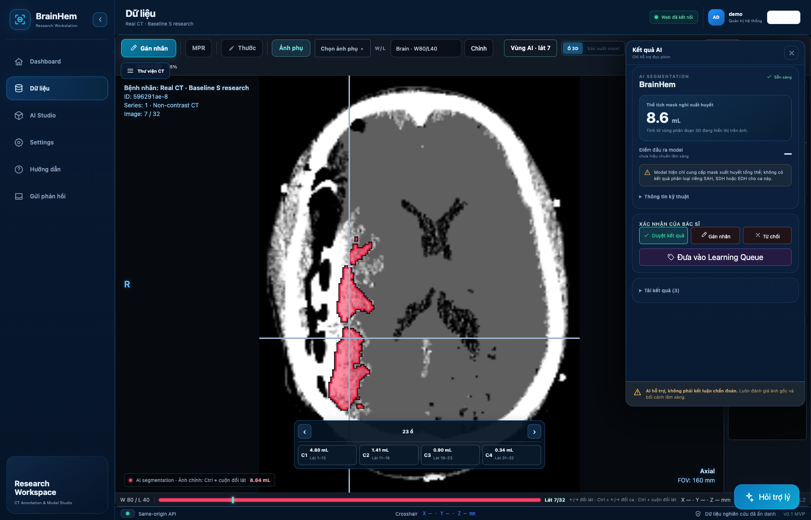

# BrainHem Assist

A graduation capstone project for brain CT hemorrhage segmentation. The model work centers on **Baseline S — BiGRU–DE-UNeXt**, combining CT and contrast-enhanced inputs, multi-scale attention fusion, and context from neighboring slices.

**[Explore the model: architecture, CT pipeline, research results and ONNX artifacts →](models/README.md)**

The accompanying web application supports CT viewing, annotation and revision review. Its inference connector requires separate configuration; uploading a scan does not automatically run the bundled model.



*Actual application capture displaying a recorded FP32 Baseline S research prediction on 32 slices of the real NiiVue CT_Electrodes sample, using a separately configured CT pipeline. This sample is not a hemorrhage benchmark; the overlay is uncalibrated and does not establish clinical accuracy. [Sample attribution](#image-source).*

## Run the application

With Docker and the Compose plugin installed, run from the repository root:

```bash
cp .env.example .env
# Set distinct admin/user passwords; enable local imports if needed.
docker compose --env-file .env -f mvp/infra/compose.public.yaml up --build
```

Open **http://127.0.0.1:8000**. Follow the [setup guide](docs/SETUP.md) for login, scan import, source installation and development checks. A new installation has no scans or inference service configured; fine-tuning and model slots M/L are unavailable.

## Repository guide

| Path | Contents |
| --- | --- |
| [`models/`](models/) | Detailed model documentation and FP32/MatMul INT8 ONNX artifacts |
| [`baseline/`](baseline/) | Python tensor loader for Baseline S |
| [`mvp/`](mvp/) | React/NiiVue application, FastAPI backend and Docker configuration |
| [`docs/SETUP.md`](docs/SETUP.md) | Installation and application use |
| [`tests/`](tests/) | Model and publication checks; API tests are in `mvp/backend/tests/` |

[GitHub Actions](https://github.com/NguyenLe2004/BrainHemAssist/actions/workflows/security.yml) runs tests, frontend checks, dependency audits and source/history secret scans. See [SECURITY.rst](SECURITY.rst) for deployment limits.

## Image source

The real CT sample comes from [NiiVue's demo images](https://github.com/niivue/niivue-demo-images#licenses), originally distributed by the Scientific Computing and Imaging Institute's [Seg3DData](https://github.com/CIBC-Internal/Seg3DData) under MIT. The [retained notice](LICENSES/Seg3DData.txt) accompanies the UI capture; the CT volume is not bundled.

## Research scope and rights

This is research software. Historical model results and the displayed prediction are not independent clinical validation. The published ONNX graphs and weights are inspectable. Original project code and model artifacts have no project-wide open-source license grant; preserve [LICENSE](LICENSE), [NOTICE](NOTICE) and [third-party notices](THIRD-PARTY-NOTICES.txt). Complete model provenance and redistribution rights remain unverified.

Credentials, private patient data, scan volumes, internal reports and agent Markdown remain excluded from publication.
