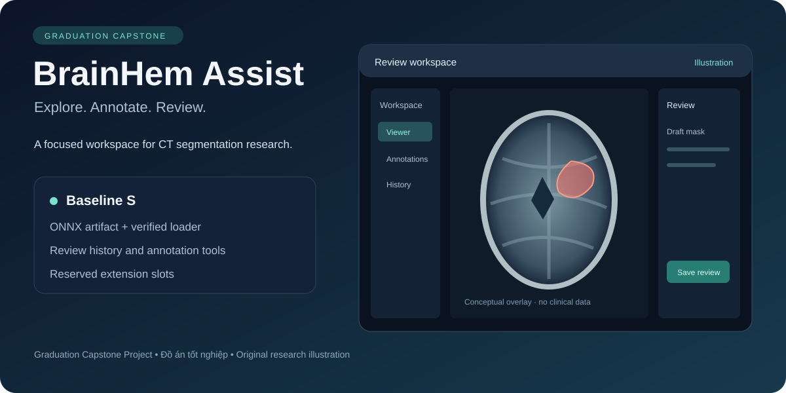
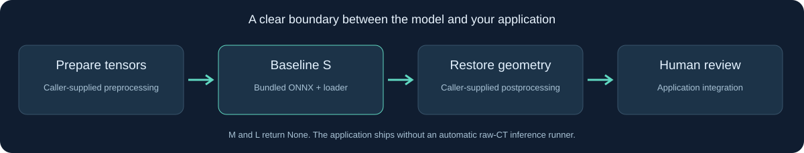

# BrainHem Assist

**Graduation Capstone Project — Đồ án tốt nghiệp**

A graduation capstone project exploring a research workspace for brain CT segmentation, annotation, and review. This public snapshot includes a **Baseline S ONNX artifact**, a small verified model loader, and a web application with review history and access controls.

**Release scope:** Baseline S is the only bundled model. M and L are reserved slots whose loaders return `None`. Their inference services remain unavailable.

**Public model disclosure:** The project owner intentionally includes `models/baseline_s.onnx` in this public release. Its graph and learned weights can be inspected and extracted by anyone downloading the repository. This publication decision does not change the third-party license and provenance notes below.

| Component | Included |
| --- | --- |
| Model | `models/baseline_s.onnx` with embedded weights |
| Python interface | Checksum verification, input validation, CPU inference |
| Web workspace | CT viewer, annotations, revision history, review tools |
| Extensions | Empty M/L loaders; caller-configured integrations |
| Checks | API tests, model smoke tests, dependency and secret scans |



The visuals above are original conceptual illustrations, not patient screenshots or clinical results.

## Run the model

Use Python 3.11 in a virtual environment, from the repository root:

The pinned ONNX Runtime 1.30.0 supports Linux x86_64/aarch64, macOS 14+ on Apple Silicon, and Windows x86_64/ARM64. It has no macOS Intel wheel; use a supported platform for the model example. The web backend can be installed separately.

```bash
python3 -m venv .venv
source .venv/bin/activate
pip install -r requirements-model.txt
```

```python
import numpy as np
from baseline import load_model

model = load_model("s")
# Synthetic tensors only: verifies the interface, not a clinical prediction.
image = np.zeros((1, 1, 512, 512), dtype=np.float32)
enhanced = np.zeros_like(image)
logits = model.predict(image, enhanced)
assert logits.shape == (1, 2, 512, 512)
assert load_model("m") is None
assert load_model("l") is None
```

Both inputs must be finite `float32` arrays of shape `[D, 1, 512, 512]`, with matching shapes and `1 <= D <= 128`. Output `logits` has shape `[D, 2, 512, 512]`. CPU execution is the default.

The loader accepts **prepared tensors**. Raw CT preprocessing, intensity transforms, segmentation postprocessing, and restoration of spatial geometry must be supplied and validated by the caller. These integrations are not bundled, and the web application does not automatically run the model on uploaded CT scans. The synthetic example above is a smoke test only.

## Start the web workspace

With Docker and the Docker Compose plugin installed:

```bash
cp .env.example .env
# Edit .env and set distinct, strong admin and user passwords.
docker compose --env-file .env -f mvp/infra/compose.public.yaml up --build
```

Open `http://127.0.0.1:8000`. The default Compose setup binds to localhost and requires passwords. The container runs as a non-root user. Upload and external PACS/inference connectors need deliberate local configuration; the default source snapshot leaves these integrations disabled. For a source install, see [PUBLISHING.rst](PUBLISHING.rst).

## Verify this snapshot

```bash
python3 scripts/check_public_tree.py --strict
python3 scripts/generate_checksums.py --check
sha256sum -c SHA256SUMS
pip install -r mvp/backend/requirements-dev.txt -r requirements-model.txt
python -m pytest -q tests
(cd mvp/backend && python -m pytest -q)
(cd mvp/frontend && npm ci && npm run build)
```

Run the strict publication check before generating local dependencies or runtime data, or on a clean export. On macOS, use `shasum -a 256 -c SHA256SUMS` for checksum verification. After editing source, regenerate the manifest with `python3 scripts/generate_checksums.py` before staging it. CI checks checksums, secrets in both source and Git history, runtime/test dependencies, and Python security findings. Local verification and its limits are recorded in [SECURITY-REVIEW.rst](SECURITY-REVIEW.rst).

## Fine-tuning availability

Fine-tuning and automatic training are **unavailable in this snapshot**. Baseline S is an inference ONNX graph; no compatible PT/PTH training checkpoint, trainable model implementation or training runtime is bundled. Dataset preparation and annotation remain available. Setting a training command alone does not enable fine-tuning; an explicitly implemented and reviewed training integration is required.

## Copyright and third-party notices

The owner has **not selected an open-source license** for original project code or the model artifact. This snapshot does not grant blanket reuse or redistribution rights. Third-party components retain their own terms; preserve [LICENSE](LICENSE), [NOTICE](NOTICE), [THIRD-PARTY-NOTICES.txt](THIRD-PARTY-NOTICES.txt), and `LICENSES/`.

The model's complete upstream provenance and weight redistribution rights remain unverified. The included notices document known references and unresolved questions; they are not a license clearance. Hosting on GitHub does not resolve those rights.

## Publication and security

Publish from this clean snapshot into a fresh Git history. Internal agent documents, checkpoints, clinical data, and private model implementations are excluded. Only this README is permitted as Markdown by the publication guard.

ONNX graphs and embedded weights remain inspectable. Generic tensor and node names remove internal naming clues, but they cannot conceal the architecture. Do not publish clinical data or local credentials. See [SECURITY.rst](SECURITY.rst) and [PUBLISHING.rst](PUBLISHING.rst) for the review and handover details.

This is research software. The packaged tensor smoke tests and conversion checks do not establish clinical accuracy or validate the complete raw-CT workflow.
