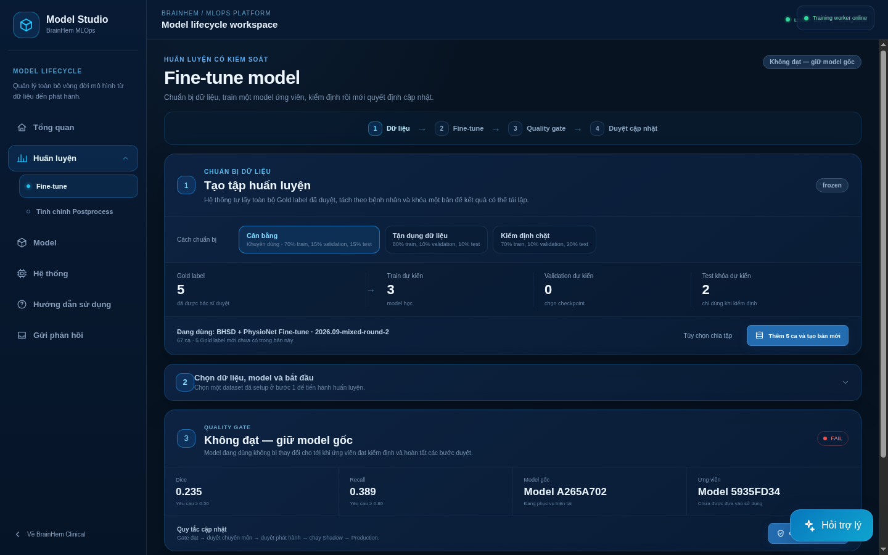
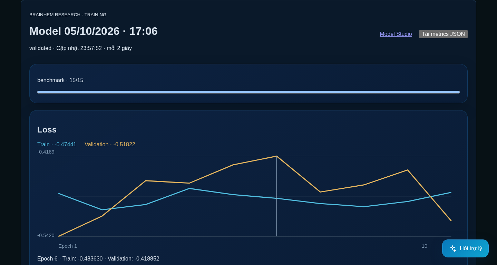
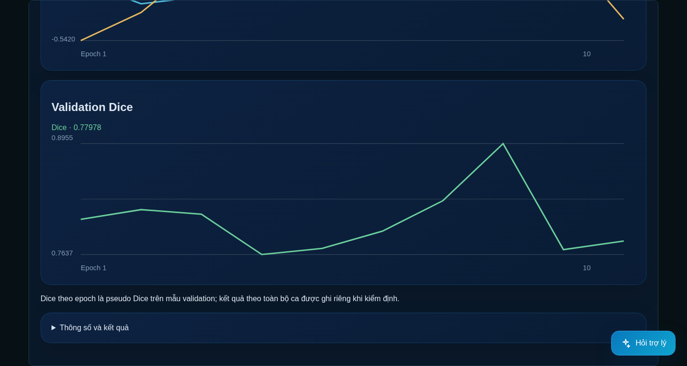

# BrainHem Assist

**Brain CT viewing, hemorrhage segmentation review and expert annotation in one research workspace.**

BrainHem Assist follows a case from CT import to mask inspection, correction and approval. It keeps annotation revisions, connects difficult cases to a learning queue, and organizes approved labels into versioned datasets. The project was developed as a graduation capstone.

The model contribution is **Baseline S — BiGRU–DE-UNeXt**: paired CT and CLAHE-enhanced inputs, multi-scale attention fusion, and bidirectional context from neighboring slices. The repository includes both **FP32 and selective MatMul INT8 ONNX artifacts**. Historical development results report macro Dice **0.6551 on 31 BHSD scans** and **0.5061 on 36 positive PhysioNet cases**; cohort limitations and comparison conditions are explained in the model documentation.

**[Explore the model: original architecture, benchmarks and ONNX artifacts →](models/README.md)**

[Application capabilities](#application-workspace) · [Installation and usage](docs/SETUP.md) · [Repository guide](#repository-guide)


*Actual application capture displaying a recorded FP32 Baseline S research prediction on 32 slices of the real NiiVue CT_Electrodes sample, using a separately configured CT pipeline. This sample is not a hemorrhage benchmark; the overlay is uncalibrated and does not establish clinical accuracy. [Sample attribution](#image-source).*

## Application workspace

The application connects image review, annotation and dataset preparation. Available actions follow the signed-in account's permissions.

| Area | What you can do |
| --- | --- |
| **Dashboard and case library** | Track case, label and AI status; search, sort and filter cases; import NIfTI or DICOM files/ZIPs when local imports are enabled. |
| **CT viewer** | Inspect axial, coronal and sagittal planes, MPR and 3D views; synchronize reference views; adjust window/level, pan and zoom, and measure distances in physical coordinates. |
| **AI result review** | With a configured inference service, track processing jobs, inspect mask overlays and individual 3D regions, view segmented volume in mL, record acceptance/rejection and notes, and download result artifacts. |
| **Annotation editor** | Correct masks with brush, eraser and filled contours; undo/redo edits; inspect, split and merge regions; use an available AI prediction as a starting label. |
| **Revision and approval workflow** | Save drafts, recover browser drafts and inspect revision history. Concurrent-save checks protect newer revisions; approval requires whole-volume review. Export approved labels with dataset-management permission. |
| **Learning queue and datasets** | Flag difficult or incorrect predictions with reasons and priority; record peer review and adjudication; assemble versioned datasets with train/validation/test splits grouped by patient identifiers. |
| **Model registry and release workflow** | Track registered models and evaluation evidence, technical/domain approvals, quality gates and shadow reports; manage release and rollback when compatible external artifacts and runtimes are supplied. |
| **Administration and system status** | Manage viewer, annotator, doctor, model-manager and administrator roles; inspect access audits, service availability and hardware status. |
| **Guidance and feedback** | Browse the searchable usage guide, ask a read-only assistant with documentation references, and submit feedback to the administrator's inbox. A language-model backend can be configured separately for the assistant. |

### AI Studio and training curves



| Training and validation loss | Validation Dice history |
| --- | --- |
|  |  |

*Original project captures: the report's Fine-tune workspace and a completed research run's loss/Dice monitor. Monitor Dice is an epoch-level proxy, separate from the full-scan [model benchmarks](models/README.md#segmentation-results). Training shown here used a separately configured research runtime; fine-tuning is unavailable in the bundled public release.*

### A case through the workspace

1. **Import and inspect.** Add your de-identified CT, find it in the case library, and review its slices and geometry.
2. **Review an AI mask when connected.** Run the configured inference pipeline, follow the job status, and inspect the overlay and segmented regions alongside the original CT.
3. **Correct and approve.** Open the annotation editor, revise the mask, review every region and the full volume, and save an approved revision under an authorized account.
4. **Build the next dataset.** Export approved labels or submit a difficult case to the learning queue, then create a dataset version for subsequent model work.

### Services and public release scope

The viewer, manual annotation, revisions, review, dataset management, accounts, local documentation assistant and feedback are included. Local scan import is **opt-in**. A fresh installation starts with an empty case library.

**Web AI inference requires a separately configured CT pipeline.** The bundled ONNX loader accepts prepared tensors; uploading a scan does not automatically invoke it. PACS/Orthanc ingestion, DICOM CT acquisition simulation and MedSAM2 annotation propagation are optional integrations requiring their own configuration, tools or model artifacts. See the [setup guide](docs/SETUP.md#optional-services) and [inference command contract](docs/SETUP.md#connect-an-external-inference-command).

**Fine-tuning, automatic training, postprocess calibration and model slots M/L are unavailable in this public release.** The application provides their management surfaces, but the required training checkpoints and runtimes are not bundled. Model registry/release controls depend on supplied compatible artifacts and recorded evidence.

## Run the application

With Docker and the Compose plugin installed, run from the repository root:

```bash
cp .env.example .env
# Set distinct admin/user passwords; enable local imports if needed.
docker compose --env-file .env -f mvp/infra/compose.public.yaml up --build
```

Open **http://127.0.0.1:8000**. Follow the [setup guide](docs/SETUP.md) for login, scan import, source installation and development checks.

The main workspace is at `/`; Model Studio is at `/model-studio`, the usage guide at `/guide`, and feedback at `/feedback`.

## Repository guide

| Path | Contents |
| --- | --- |
| [`models/`](models/) | Detailed model documentation and FP32/MatMul INT8 ONNX artifacts |
| [`baseline/`](baseline/) | Python tensor loader for Baseline S |
| [`mvp/`](mvp/) | React/NiiVue application, FastAPI backend and Docker configuration |
| [`docs/SETUP.md`](docs/SETUP.md) | Installation and application use |
| [`tests/`](tests/) | Model and publication checks; API tests are in `mvp/backend/tests/` |

[GitHub Actions](https://github.com/NguyenLe2004/BrainHemAssist/actions/workflows/security.yml) runs tests, frontend checks, dependency audits and source/history secret scans. See [SECURITY.rst](SECURITY.rst) for deployment limits.

## Image source

The real CT sample comes from [NiiVue's demo images](https://github.com/niivue/niivue-demo-images#licenses), originally distributed by the Scientific Computing and Imaging Institute's [Seg3DData](https://github.com/CIBC-Internal/Seg3DData) under MIT. The [retained notice](LICENSES/Seg3DData.txt) accompanies the UI capture; the CT volume is not bundled.

## Research scope and rights

This is research software. Historical model results and the displayed prediction are not independent clinical validation. The project owner publishes the original code, model artifacts and architecture diagram; no project-wide open-source license is granted for those contributions. The ONNX graphs and weights are inspectable. Third-party components retain their own terms; see [LICENSE](LICENSE), [NOTICE](NOTICE) and [third-party notices](THIRD-PARTY-NOTICES.txt).

Credentials, private patient data, scan volumes, internal reports and agent Markdown remain excluded from publication.
