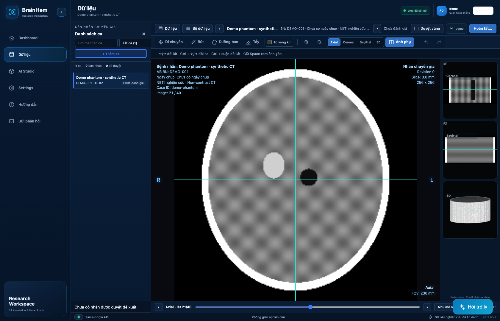
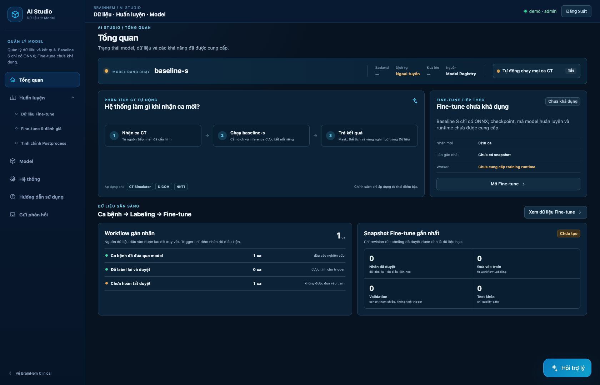

# BrainHem Assist

A brain CT research workspace for viewing scans, annotating regions, and reviewing segmentation revisions. Developed as a graduation capstone project (đồ án tốt nghiệp), this repository includes the web application and one Baseline S ONNX model with a verified Python loader.


*Actual browser capture of the public application with isolated synthetic fixture data. The scan is a demonstration phantom, not patient data or a model prediction; this demo case is not seeded by default.*

## What is included

| Component | Public snapshot |
| --- | --- |
| CT workspace | Multi-planar viewing, annotation tools, case library and revision review |
| Access control | Authenticated workspace with role-based permissions |
| Model Studio | Dataset and model management UI; training runtime is unavailable |
| Baseline S | Bundled ONNX weights and a checksum-verified CPU tensor loader |
| Integrations | Interfaces for caller-configured PACS, upload and inference services |
| Verification | API and model tests, frontend checks, dependency audits and source/history secret scans |

Only Baseline S is bundled. M/L are reserved slots whose loaders return `None`. The web application does not automatically apply the ONNX model to uploaded scans; a validated CT pipeline and inference connector are required.

## Start the web application

With Docker and the Docker Compose plugin installed, run from the repository root:

```bash
cp .env.example .env
# Set distinct, strong admin and user passwords in .env.
docker compose --env-file .env -f mvp/infra/compose.public.yaml up --build
```

Open **http://127.0.0.1:8000**. Compose binds to localhost and the container runs as a non-root user. Upload, PACS and inference services require local configuration. For Python/Node source installation, see [PUBLISHING.rst](PUBLISHING.rst#source-installation).

## Explore the model

The [Baseline S model documentation](models/README.md) describes the artifact, architecture observed in its graph, input/output interface, Python example, and validation limits. Opening the [`models/`](models/) directory on GitHub displays that page automatically.

The loader accepts two prepared `float32` tensors; it does not provide CT preprocessing or spatial restoration. Fine-tuning is unavailable because no compatible training checkpoint or trainable implementation is included.

## Application views



*Annotation tools rendered by the application using the same synthetic phantom. The initial mask is empty.*



*Model Studio captured with no training runtime or external inference service configured. Case counts and records are synthetic screenshot fixtures; no model inference was run. These screenshots demonstrate the UI, not segmentation accuracy.*

## Repository guide

| Path | Purpose |
| --- | --- |
| [`mvp/frontend/`](mvp/frontend/) | React application and NiiVue-based imaging workspace |
| [`mvp/backend/`](mvp/backend/) | FastAPI API, access controls, case storage and integration adapters |
| [`models/`](models/) | Baseline S artifact and detailed model documentation |
| [`baseline/`](baseline/) | Verified ONNX loading and tensor inference interface |
| [`tests/`](tests/) | Model interface tests; API tests are in `mvp/backend/tests/` |
| [`scripts/`](scripts/) | Publication guard and checksum tools |

## Verification

```bash
python3 scripts/check_public_tree.py
python3 scripts/generate_checksums.py --check
sha256sum -c SHA256SUMS
```

On macOS, use `shasum -a 256 -c SHA256SUMS`. The `--strict` publication check is intended for a clean export without `.git`, dependencies or runtime data. CI also runs backend/model tests, frontend build and logic checks, dependency audits, and secret scans of source and Git history. See the [GitHub workflow](https://github.com/NguyenLe2004/BrainHemAssist/actions/workflows/security.yml), [verification record](SECURITY-REVIEW.rst), and [publication instructions](PUBLISHING.rst).

## Research scope and rights

This is research software. Tensor smoke tests do not establish clinical accuracy or validate an end-to-end raw-CT workflow. No reproducible clinical benchmark is provided in this snapshot.

The owner intentionally publishes the ONNX graph and embedded weights, which anyone downloading the repository can inspect and extract. Original project code and the model have no project-wide open-source license grant. Model provenance and redistribution rights remain unverified; preserve [LICENSE](LICENSE), [NOTICE](NOTICE), [third-party notices](THIRD-PARTY-NOTICES.txt) and [`LICENSES/`](LICENSES/).

Credentials, patient data, internal reports and agent Markdown remain excluded by the publication policy. See [SECURITY.rst](SECURITY.rst) for security scope and deployment limits.
