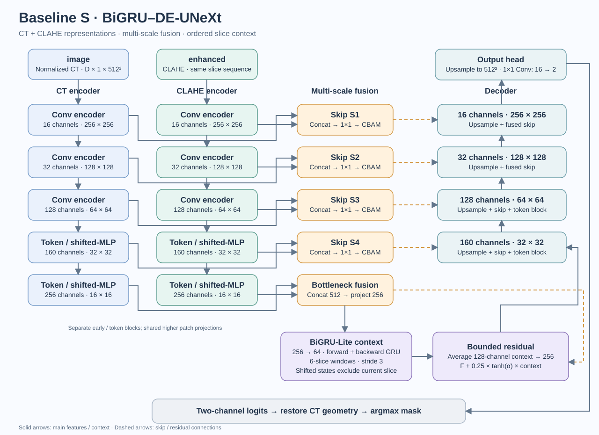

# Baseline S — BiGRU–DE-UNeXt

[← BrainHem Assist](../README.md) · [Installation and application guide](../docs/SETUP.md)

Baseline S is the project's brain CT hemorrhage segmentation model. It combines two representations of the same scan: a CT intensity input and a CLAHE-enhanced input. Multi-scale fusion joins their spatial features, while a lightweight bidirectional GRU adds context from neighboring slices before decoding a segmentation mask.

The published FP32 ONNX artifact was matched to the project's original BiGRU baseline checkpoint. The architecture and pipeline below describe that baseline; they do not describe the unimplemented M/L slots or a different model variant.

## Architecture



*Architecture of the published Baseline S, reconciled against the original implementation and exported ONNX graph. The model contains two GRU operations, for forward and backward slice context.*

### Two views of the same CT

The CT branch retains the windowed intensity representation. The second branch applies **CLAHE** (Contrast Limited Adaptive Histogram Equalization) to emphasize local contrast. Both branches receive the same ordered slices with matching spatial geometry; the enhanced tensor is not a second scan.

Each encoder progresses through **16, 32, 128, 160 and 256 channels**, combining convolutional feature extraction with tokenized MLP blocks. The earlier encoder paths are separate; the higher `patch3` and `patch4` projection modules share weights between the two branches.

### Multi-scale fusion and skip connections

At four encoder levels, features from the CT and CLAHE branches are fused through **CBAM** (Convolutional Block Attention Module). Its channel and spatial gates adjust which features contribute to each decoder skip connection.

At the deepest level, the two 256-channel representations are concatenated into 512 channels and projected back to 256. This fused representation supplies the slice-context module and decoder. The four skip connections preserve finer spatial information during upsampling.

### BiGRU-Lite slice context

The context module reduces the feature representation to **64 channels** and uses forward and backward GRUs over **six-slice windows with stride three**. Each direction's hidden states are shifted by one slice, so the context comes from earlier and later slices rather than the current slice itself. Overlapping windows' 128-channel contexts are averaged, then projected back to 256 channels.

The context is added to the spatial features through a bounded residual coefficient:

```text
output features = F + 0.25 × tanh(α) × context
```

Here, `F` is the fused spatial feature and `α` is a learned scalar. Bounding the context coefficient limits the strength of the recurrent update. Slice order therefore matters: the leading tensor dimension must not be used as an arbitrary batch of unrelated scans.

### Decoder and mask

The upsampling decoder combines the context-enriched features with the four fused skips. Its final 16-channel representation is mapped to **two logit channels** by the segmentation head:

| Class index | Meaning |
| --- | --- |
| `0` | Background |
| `1` | Hemorrhage |

The ONNX output contains logits, without a final Softmax. The baseline selects the winning class with `argmax`; logits are not calibrated confidence scores. The original baseline does **not** apply connected-component filtering after prediction.

## CT preparation and inference pipeline

The original research pipeline prepares a scan before passing tensors to the model:

1. Preserve slice ordering and through-plane geometry, and crop the nonzero image region while recording its original coordinates.
2. Clip CT intensities to **12–89 HU**. Normalize using mean **47.800434** and standard deviation **18.999517**, then resample the in-plane spacing to **0.488281 mm**.
3. Reconstruct windowed HU from the normalized tensor and map it to `[0,1]` for Kornia CLAHE (clip limit **2.0**, grid **8 × 8**). Preserve saturated zero/one endpoints, then map the enhanced image back to the same fixed CT normalization range; do not normalize each slice independently.
4. Run **512 × 512** spatial tiles with 50% overlap, blend predictions with Gaussian weights, and combine four XY mirror augmentations.
5. Restore the logits to the original image geometry **before** selecting the mask by class `argmax`.

Through-plane spacing is preserved; the sequence module supplies cross-slice context. Spatial restoration is necessary before interpreting a mask in the scan's original coordinates or measuring physical volume.

These settings document the original pipeline. The public [`baseline`](../baseline/) package accepts prepared tensors; it does not bundle that complete CT preprocessing, tiling, augmentation or geometry-restoration pipeline. The web application's external inference connector is a separate integration and is disabled by default.

## Published tensor interface

| Tensor | Type and shape | Role |
| --- | --- | --- |
| `image` | Finite `float32`, `[D, 1, 512, 512]` | Prepared CT slice sequence |
| `enhanced` | Finite `float32`, `[D, 1, 512, 512]` | Aligned CLAHE representation |
| `logits` | `float32`, `[D, 2, 512, 512]` | Background and hemorrhage scores |

Both inputs must have identical shapes. The loader accepts **1–128 ordered slices** per call. That interface limit is not an assurance that every sequence length or integration has been clinically validated. Install and use the tensor API separately from the web application; see the [setup guide](../docs/SETUP.md).

## Training approach

Training followed the nnU-Net v2 2D workflow, with 121 training scans and 31 model-selection scans (fold 0). Each training batch contained two ordered six-slice sequences. The published weights correspond to the selected checkpoint saved at epoch 105.

The objective combined Dice and cross-entropy with deep supervision, plus a persistent-recall term weighted **0.15**. This term penalizes missed foreground supported by an adjacent slice within a three-pixel in-plane tolerance. Training used SGD with Nesterov momentum; the backbone was frozen for the first 30 epochs, then trained at one-tenth the context adapter's learning rate. These describe the training design, without claiming an independently measured benefit from each component.

## Research results

The original PyTorch/TTA research runs recorded the following **macro Dice**, computed per scan and averaged across the cohort. These are historical development results, not measurements newly obtained from the distributed ONNX artifacts.

| Cohort | Cases | Macro Dice | Interpretation |
| --- | --- | --- | --- |
| BHSD | 31 | **0.6551** | Model-selection cohort; one patient identifier prefix overlaps training records |
| PhysioNet, positive cases | 36 | **0.5061** | Exploratory cohort consulted during development |

BHSD was used for model selection and has the stated overlap, so it cannot serve as an independent test set. The PhysioNet result covers positive cases and was consulted during development; it does not establish independent performance or specificity on negative scans. No independent clinical benchmark or prospective validation is claimed.

The original trainable checkpoint, full training runtime and evaluation datasets are not bundled. Fine-tuning remains unavailable in this public release.

## Recorded application prediction


*Actual application capture displaying a recorded FP32 Baseline S research prediction on 32 slices of the real NiiVue CT_Electrodes sample, using a separately configured CT pipeline. The sample is not a hemorrhage benchmark; the overlay is uncalibrated and is not evidence of diagnostic accuracy. [Sample attribution](../README.md#image-source).*

The pink regions and displayed volume are predictions, not expert labels or ground truth.

This demonstrates the connection between model output and the review interface. It does not mean the default application runs inference automatically on import.

## ONNX artifacts and quantization

| Artifact | Precision | Size |
| --- | --- | --- |
| [`baseline_s.onnx`](baseline_s.onnx) | FP32 baseline | 8,233,816 bytes (7.85 MiB) |
| [`baseline_s.int8.onnx`](baseline_s.int8.onnx) | Selective MatMul INT8; mixed precision | 6,969,048 bytes (6.65 MiB) |

The INT8 variant dynamically quantizes the **12 original MatMul sites** and is **15.36% smaller**. Convolutions and recurrent context remain FP32. This is a deployment variant of the same model, not an entirely INT8 network; reduced file size does not establish faster inference or preserved clinical accuracy.

On the 32-slice demonstration input, the foreground mask's Dice against FP32 was **0.9832**. This measures agreement between the two formats, without a ground-truth label. CPU checks also exercised two-, six- and seven-slice inputs to cover recurrent window handling.

To recreate the variant without overwriting the bundled artifact:

```bash
pip install -r requirements-quantization.txt
python scripts/quantize_model.py --output /tmp/baseline_s.int8.onnx
```

Run these commands from the repository root in the environment described by the [setup guide](../docs/SETUP.md).

## Rights and provenance

The published graphs and weights can be inspected. Original model artifacts have no new open-source license grant; complete provenance and redistribution rights remain unverified. Preserve [LICENSE](../LICENSE), [NOTICE](../NOTICE) and [third-party notices](../THIRD-PARTY-NOTICES.txt), which retain the upstream source-lineage references.
