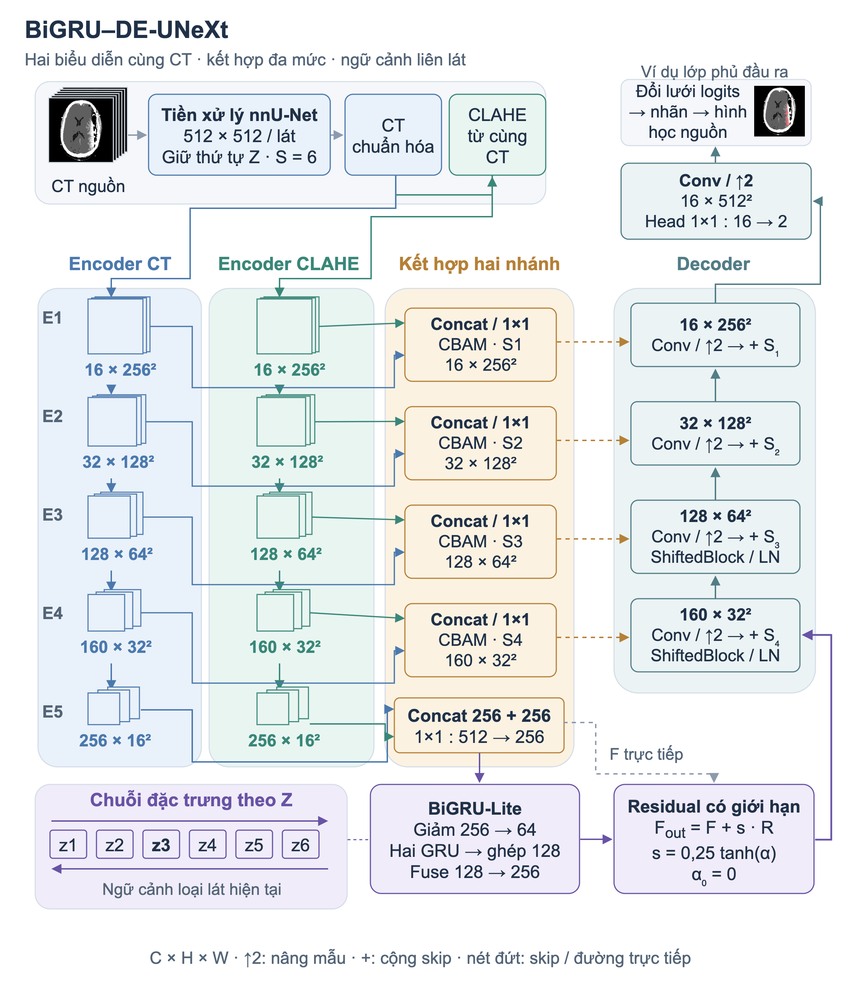

# Baseline S — BiGRU–DE-UNeXt

[← BrainHem Assist](../README.md) · [Setup and tensor API](../docs/SETUP.md#onnx-inference)

Brain CT hemorrhage segmentation using paired CT/CLAHE inputs and bidirectional slice context. The published FP32 weights match the original BiGRU baseline checkpoint selected at epoch 105.

## Architecture



*Original project diagram. CT thumbnails use the openly licensed demonstration sample attributed in the [project README](../README.md#image-source).*

## Segmentation results

Results from the original **PyTorch research runs with XY mirror TTA**. Macro metrics are computed per scan and then averaged; pooled Dice combines voxel counts across the cohort.

| Evaluation cohort | Scans | Macro Dice | Pooled Dice | Macro precision | Macro recall | Mean HD95 (mm) |
| --- | ---: | ---: | ---: | ---: | ---: | ---: |
| BHSD historical validation | 31 | **0.6551** | **0.7595** | 0.7393 | 0.6355 | 25.758 |
| PhysioNet positive cases | 36 | **0.5061** | **0.7147** | 0.5720 | 0.5163 | 36.490 |

BHSD was used for checkpoint selection and has one patient-identifier prefix overlapping training records. PhysioNet was consulted during development and contains positive cases only in this evaluation. These are development results, not independent clinical validation; specificity on negative scans was not established.

## Model comparison

The same BHSD 31-scan and PhysioNet 36-positive-scan cohorts were used for these historical comparisons. Dice is the **per-scan macro average**.

| Model / configuration | Parameters (M) | BHSD Dice | PhysioNet Dice |
| --- | ---: | ---: | ---: |
| DEUNeXt + CLAHE, epoch 958 | — | — | 0.4862 |
| MONAI UNet | 4.344 | 0.6172 | 0.4039 |
| MONAI AttentionUnet | 5.616 | 0.6066 | 0.3905 |
| MONAI DynUNet | 7.930 | 0.5996 | 0.4071 |
| MONAI SegResNet | 6.292 | 0.6036 | 0.4292 |
| MONAI SwinUNETR | 15.703 | 0.5175 | 0.3350 |
| **BiGRU–DE-UNeXt, epoch 105** | **2.027** | **0.6551** | **0.5061** |

Training budgets, optimizers and 2D/3D inference paths differ, so this is a comparison of completed configurations, **not a controlled architecture ablation**. A dash means the comparable result was not retained. Parameter counts describe the original trainable networks, before ONNX export and folding. Comparison models and evaluation datasets are not bundled.

## Compute benchmark

Historical **PyTorch FP16 autocast** measurement on an **RTX 3050**, using one CT volume of **512 × 512 × 47** voxels. Weights were loaded before one warm-up and three synchronized measurements.

| Measurement | Result |
| --- | ---: |
| Trainable parameters | 2,027,148 |
| Mean processing time / CT | 2.064 s |
| Range across three measurements | 2.044–2.094 s |
| Peak allocated tensor memory | 2,633.6 MiB |
| Main-operation MACs / slice | 3.813 GMAC |
| Corresponding FLOPs / slice | 7.625 GFLOPs |

The timer includes CT reading, preprocessing, a single prediction pass and mask restoration; it excludes weight loading, file writing, job queues and API overhead. Operation counts use two FLOPs per MAC and exclude CLAHE, resampling, postprocessing and overlapping context-window overhead. These are not CPU ONNX or INT8 latency measurements.

## ONNX artifacts and quantization

| Artifact | Precision | Size |
| --- | --- | --- |
| [`baseline_s.onnx`](baseline_s.onnx) | FP32 baseline | 8,233,816 bytes (7.85 MiB) |
| [`baseline_s.int8.onnx`](baseline_s.int8.onnx) | Selective MatMul INT8; mixed precision | 6,969,048 bytes (6.65 MiB) |

The INT8 variant dynamically quantizes the **12 original MatMul sites** and is **15.36% smaller**. Convolutions and recurrent context remain FP32. This is a deployment variant of the same model, not an entirely INT8 network; reduced file size does not establish faster inference or preserved clinical accuracy.

On the 32-slice demonstration input, the foreground mask's Dice against FP32 was **0.9832**. This measures agreement between the two formats, without a ground-truth label. CPU checks also exercised two-, six- and seven-slice inputs to cover recurrent window handling.

To recreate the variant without overwriting the bundled artifact:

```bash
pip install -r requirements-quantization.txt
python scripts/quantize_model.py --output /tmp/baseline_s.int8.onnx
```

Run these commands from the repository root in the environment described by the [setup guide](../docs/SETUP.md).

## Rights and provenance

The published graphs and weights can be inspected. Original model artifacts have no new open-source license grant; complete provenance and redistribution rights remain unverified. Preserve [LICENSE](../LICENSE), [NOTICE](../NOTICE) and [third-party notices](../THIRD-PARTY-NOTICES.txt), which retain the upstream source-lineage references.
